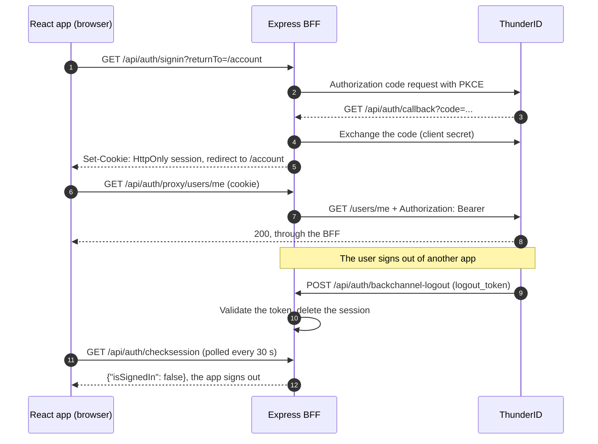

# ThunderID Express BFF Quickstart

A Backend for Frontend (BFF) for the [React quickstart](../react), built with Express and
`@thunderid/express`. Sign-in runs on this server, which keeps the access, refresh, and ID tokens.
The browser only holds an `HttpOnly` session cookie that scripts cannot read, so a script injected
into the page has no token to steal.

It implements the backend contract that `@thunderid/react` and `@thunderid/browser` use when
`endpoints.backend` is set, and it ends its sessions when ThunderID sends an OpenID Connect
back-channel logout.

## How it works



The app and the BFF share one origin. In development the React dev server forwards `/api/auth`
to this server, so the session cookie is first party and no CORS setup is needed.

## Endpoints

All under `/api/auth`. Every endpoint the browser SDK calls requires the
`X-Requested-With: XMLHttpRequest` header, which a cross-site page cannot send without a CORS
preflight, so the cookie cannot be used for cross-site request forgery.

| Endpoint | What it does |
|---|---|
| `GET /signin` | Starts sign-in and comes back to the app path in `returnTo` |
| `GET /callback` | The OAuth redirect URI. Exchanges the code and sets the session cookie |
| `GET /session` | `{isSignedIn, user, expiresAt, scope}`. Refreshes an expired access token first |
| `GET /checksession` | `{isSignedIn}` only. Never refreshes, so the app can poll it |
| `POST /refresh` | Refreshes the access token with the refresh token held here |
| `POST /signout` | Ends the BFF session and returns `{redirectUrl}`, the ThunderID end-session URL |
| `POST /token` | The access token, without the refresh token, for APIs the app calls directly |
| `ALL /proxy/*` | Forwards to `API_BASE_URL` with `Authorization: Bearer`. `401 login_required` when the session is gone |
| `POST /backchannel-logout` | Receives ThunderID's logout token and deletes the session it names |

## Prerequisites

- Node.js 22+
- A running ThunderID instance (default: `https://localhost:8090`)
- A confidential application in ThunderID, with a client ID and client secret

## Getting started

1. In the ThunderID Console, open your application, go to **Advanced Settings → OAuth2
   Configuration**, and set:

   | Field | Value |
   |---|---|
   | Authorized redirect URI | `http://localhost:5173/api/auth/callback` |
   | Post-Logout Redirect URI | `http://localhost:5173` |
   | Back-Channel Logout URI | `http://localhost:3001/api/auth/backchannel-logout` |

   The redirect URIs are on the React app's origin. ThunderID calls the back-channel logout URI
   directly, server to server, so it points at the BFF itself.

2. Copy the environment file and fill in your application's credentials:
   ```sh
   cp .env.example .env
   ```

3. Install dependencies and start the BFF on port 3001:
   ```sh
   npm install
   npm start
   ```

4. In the React quickstart, turn on BFF mode in its `.env` and start it:
   ```sh
   cd ../react
   echo "VITE_THUNDERID_BFF=true" >> .env
   npm install
   npm run dev
   ```

Open [http://localhost:5173](http://localhost:5173) and sign in. The app never receives a refresh
token or an ID token. The Token debug page shows the access token from `POST /api/auth/token`.

## Back-channel logout

When the user's ThunderID session ends anywhere else, ThunderID posts a signed logout token to
`/api/auth/backchannel-logout`. The SDK's `handleBackchannelLogout()` checks the signature, issuer,
audience, and replay, then deletes the BFF session that joined the ended ThunderID session. The
React app finds out the next time it asks `/api/auth/checksession`, every 30 seconds and whenever
the tab gets focus, or on its next API call, and signs the user out.

To try it:

1. ThunderID refuses `localhost` and private network addresses as back-channel logout URIs by
   default. For local testing only, turn that off in the server's `deployment.yaml` and restart it:
   ```yaml
   oauth:
     logout:
       backchannel:
         reject_private_addresses: false
   ```
2. Make sure the authentication flow has the **Check SSO Session** and **Save / Load Session**
   nodes. Without them ThunderID records no session and sends no logout.
3. Sign in to the React app, then sign in to a second application in the same browser, so both
   join one ThunderID session.
4. Sign out of the second application. Within 30 seconds, or as soon as you switch back to the
   React app's tab, it shows you as signed out. The BFF logs the session it ended.

## Going to production

- Serve the React build and the BFF from the same origin, for example behind one reverse proxy,
  and set `APP_URL` to it. With `https`, the session cookie is marked `Secure`.
- Remove `NODE_TLS_REJECT_UNAUTHORIZED=0`.
- The SDK keeps sessions in memory. With more than one BFF instance, give it a shared store, since
  ThunderID's back-channel request reaches only one of them.

## Configuration

| Variable | Default | Description |
|---|---|---|
| `THUNDERID_BASE_URL` | `https://localhost:8090` | Your ThunderID deployment |
| `THUNDERID_CLIENT_ID` | | The application's client ID |
| `THUNDERID_CLIENT_SECRET` | | The application's client secret. Stays on the server |
| `APP_URL` | `http://localhost:5173` | The origin the browser opens the app on |
| `API_BASE_URL` | `THUNDERID_BASE_URL` | The API the proxy forwards to |
| `PORT` | `3001` | The port the BFF listens on |

## Learn more

- [ThunderID Docs](https://thunderid.dev/docs)
- [Back-Channel Logout in ThunderID](https://thunderid.dev/docs/guides/protocols/oauth-oidc/backchannel-logout)
- [`@thunderid/express` SDK reference](https://thunderid.dev/docs/sdks/javascript/express)
